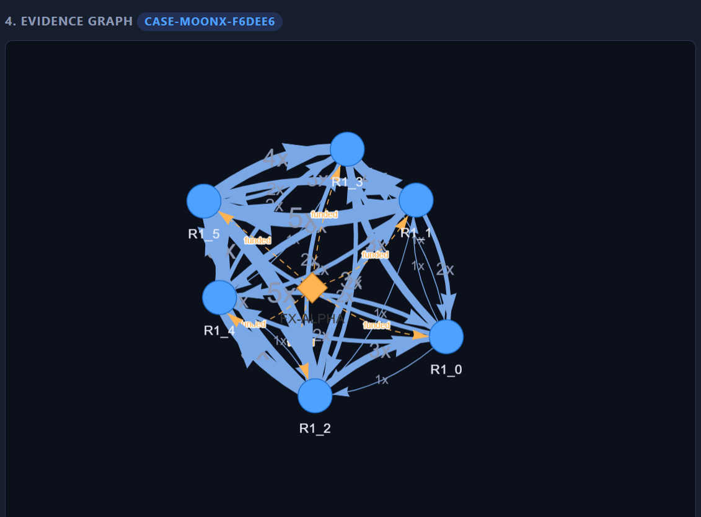

# Wash-Trade Investigator

**A graph-powered AI agent that finds wash trading in crypto markets, flags the wallets, and shows the exact subgraph that proves it.**

Built for **Graph Hacks: Context for AI Agents** (WeMakeDevs x FalkorDB), **Track 1: Agents That Act on Connected Data**.

- Demo video: `<ADD LINK>`
- Live demo: `<ADD LINK, or delete this line>`



<!-- Add a screenshot of the evidence graph at docs/evidence-graph.png -->

---

## The problem

Wash trading is when a group of wallets trade a token back and forth among themselves to fake volume and make it look popular. Each individual trade looks normal. The fraud is only visible in the **shape of the connections**: money going A -> B -> C -> A again and again, among wallets funded by the same source.

A table of trades hides that shape. A graph shows it.

## What the agent does

1. **Finds** wallets that trade a token in circles (multi-hop cycle queries in FalkorDB).
2. **Measures** how much of the token's volume stays inside that group, and how uniform the trade sizes are.
3. **Traces** funding: do these wallets share a funder?
4. **Ranks** the wallets with PageRank to find the hub.
5. **Acts:** flags the wallets and writes a `Case` node linked to them in the graph.
6. **Explains:** the UI draws the exact subgraph of wallets, trades and funders behind the decision, with every tool call listed.

It also checks suspicious-looking groups that turn out to be normal, and leaves them alone.

### Example result (token MOONX)

| Evidence                                              | Value                                                                          |
| ----------------------------------------------------- | ------------------------------------------------------------------------------ |
| Cluster found                                         | `R1_0` to `R1_5` (6 wallets)                                                   |
| Share of the token's volume traded inside the cluster | 97.5%                                                                          |
| Trade size spread inside the cluster                  | 5.6%                                                                           |
| Shared funder                                         | `FX-ALPHA` (all 6 wallets)                                                     |
| Top hub (PageRank)                                    | `R1_2`                                                                         |
| Decision                                              | Flagged, case `CASE-MOONX-f6dee6` written to the graph                         |
| Second cluster `W142`, `W180`, `W192`                 | Not flagged: 50% internal volume, widely varying trade sizes, no shared funder |

## Why FalkorDB is essential

The detection itself is graph queries. Remove FalkorDB and the agent cannot see rings at all.

- **Multi-hop cycle queries** find A->B->A and A->B->C->A patterns.
- **Shared-funder pattern** (`(w)-[:FUNDED_BY]->(f)<-[:FUNDED_BY]-(w2)`) links wallets that look unrelated.
- **PageRank** (`algo.pageRank`) ranks hubs inside a ring.
- **The action is written back to the graph** as a `Case` node, so later investigations can build on earlier decisions.

## Architecture

```
Browser UI (vis-network graph)
        |
   FastAPI  (app.py)
        |
   Agent  (agent.py)  -- LLM mode: Claude chooses tools  /  Offline mode: fixed playbook
        |
   Graph tools  (tools.py)  -- each tool is a Cypher query
        |
   FalkorDB  (FalkorDB Cloud or Docker)
```

The agent only sees the world through the graph tools.

### Data model

```
(:Wallet {id, flagged})-[:TRADED {token, amount, ts}]->(:Wallet)
(:Wallet)-[:FUNDED_BY]->(:Funder {id})
(:Case {id, token, reason, created})-[:FLAGGED]->(:Wallet)
```

`seed.py` generates 300 normal wallets with random trades, plus two planted wash-trading rings (MOONX: 6 wallets, ZAPT: 4 wallets). The ring membership is **never stored in the graph**; the agent must discover it.

### Agent tools and the key queries

| Tool                                   | What it does                                     |
| -------------------------------------- | ------------------------------------------------ |
| `find_trade_cycles(token)`             | Round trips and triangles, grouped into clusters |
| `cluster_stats(wallets, token)`        | Internal share of volume, trade-size spread      |
| `shared_funders(wallets)`              | Funders that paid for 2+ of the wallets          |
| `rank_hubs(wallets, token)`            | PageRank, with a degree fallback                 |
| `flag_wallets(wallets, token, reason)` | **Action:** flags wallets, creates a `Case`      |

Round-trip trading (A->B->A, repeated):

```cypher
MATCH (a:Wallet)-[x:TRADED]->(b:Wallet)-[y:TRADED]->(a)
WHERE x.token = $t AND y.token = $t AND a.id < b.id
RETURN a.id, b.id, count(x) AS legs
```

Three-wallet cycles:

```cypher
MATCH (a:Wallet)-[x:TRADED]->(b:Wallet)-[y:TRADED]->(c:Wallet)-[z:TRADED]->(a)
WHERE x.token = $t AND y.token = $t AND z.token = $t AND a.id < b.id AND a.id < c.id
RETURN DISTINCT a.id, b.id, c.id LIMIT 300
```

Shared funders:

```cypher
MATCH (w:Wallet)-[:FUNDED_BY]->(f:Funder) WHERE w.id IN $ids
RETURN f.id, collect(w.id) AS wallets
```

Share of volume that stays inside the cluster:

```cypher
MATCH (a:Wallet)-[t:TRADED]->(b:Wallet)
WHERE t.token = $tok AND a.id IN $ids AND b.id IN $ids
RETURN count(t), sum(t.amount), min(t.amount), max(t.amount)
```

PageRank:

```cypher
CALL algo.pageRank('Wallet', 'TRADED') YIELD node, score RETURN node.id, score
```

Action (writes back to the graph):

```cypher
MERGE (c:Case {id: $cid}) SET c.token = $tok, c.reason = $reason, c.created = $now
WITH c UNWIND $ids AS i MATCH (w:Wallet {id: i})
SET w.flagged = true MERGE (c)-[:FLAGGED]->(w)
```

## Tech stack and skills demonstrated

| Area           | What was used                                                    |
| -------------- | ---------------------------------------------------------------- |
| Graph database | FalkorDB, Cypher, graph modeling, PageRank                       |
| Agent design   | Tool-calling agent loop, LLM mode and deterministic offline mode |
| Backend        | Python, FastAPI, Uvicorn                                         |
| Frontend       | HTML/JS single-page UI, vis-network graph visualization          |
| Data           | Synthetic data generation with planted ground truth              |
| DevOps         | Docker Compose, FalkorDB Cloud, environment-based configuration  |

### Two modes, same tools

- **LLM mode:** set `ANTHROPIC_API_KEY` and Claude decides which graph tools to call and writes the verdict.
- **Offline mode (default, no key needed):** a fixed playbook calls the same tools in the same order and applies a transparent scoring rule (volume concentration, uniform sizes, shared funder, repeated cycles).

The UI shows which mode ran.

## Run it

Requirements: Python 3.10+ and a FalkorDB instance (FalkorDB Cloud free tier, or Docker).

### 1. Get FalkorDB

**Option A: FalkorDB Cloud (no Docker).** Create a free instance at https://app.falkordb.cloud and note the host, port, username and password. Use the host **without** the port.

**Option B: Docker.**

```bash
docker compose up -d      # database on 6379, FalkorDB Browser on http://localhost:3000
```

### 2. Install

```bash
python -m venv .venv
source .venv/bin/activate          # Windows: .venv\Scripts\Activate.ps1
pip install -r requirements.txt
```

### 3. Configure (only for a remote database)

macOS/Linux:

```bash
export FALKORDB_HOST=your-host.cloud     # host only, no port
export FALKORDB_PORT=12345
export FALKORDB_USERNAME=falkordb
export FALKORDB_PASSWORD=your-password
# export FALKORDB_SSL=1                  # only if your instance requires TLS
```

Windows PowerShell:

```powershell
$env:FALKORDB_HOST="your-host.cloud"
$env:FALKORDB_PORT="12345"
$env:FALKORDB_USERNAME="falkordb"
$env:FALKORDB_PASSWORD="your-password"
```

Optional, to use Claude as the agent: `ANTHROPIC_API_KEY`.

### 4. Load the data and start

```bash
python seed.py
uvicorn app:app --port 8000
```

Open http://localhost:8000, click **MOONX**, then **Investigate**. Try **NOVA** or **PEPE2** to see it flag nothing.

`seed.py` prints the planted ring wallets at the end so you can check the agent's answer. Expected flags: MOONX -> `R1_0` to `R1_5`, ZAPT -> `R2_0` to `R2_3`.

### Inspect the graph yourself

In FalkorDB Browser, choose graph `washtrade` and run:

```cypher
MATCH (c:Case)-[:FLAGGED]->(w:Wallet) RETURN c, w
```

## Project layout

```
db.py        FalkorDB connection (local or cloud)
seed.py      synthetic data with planted rings
tools.py     graph tools (Cypher)
agent.py     LLM and offline agent loops
app.py       FastAPI server
static/      single-page UI with the evidence graph
```

## Limitations and next steps

- The data is synthetic. Real chains would add wallet clustering by address heuristics and timing.
- Scoring thresholds in offline mode are hand-set; with real data they would be tuned.
- Natural extensions: streaming tool calls to the UI, multi-token investigations, an MCP server exposing the same tools to any agent client.

## Team

Built by Renuka Somwanshi ([GitHub](https://github.com/bibliophile17)).
